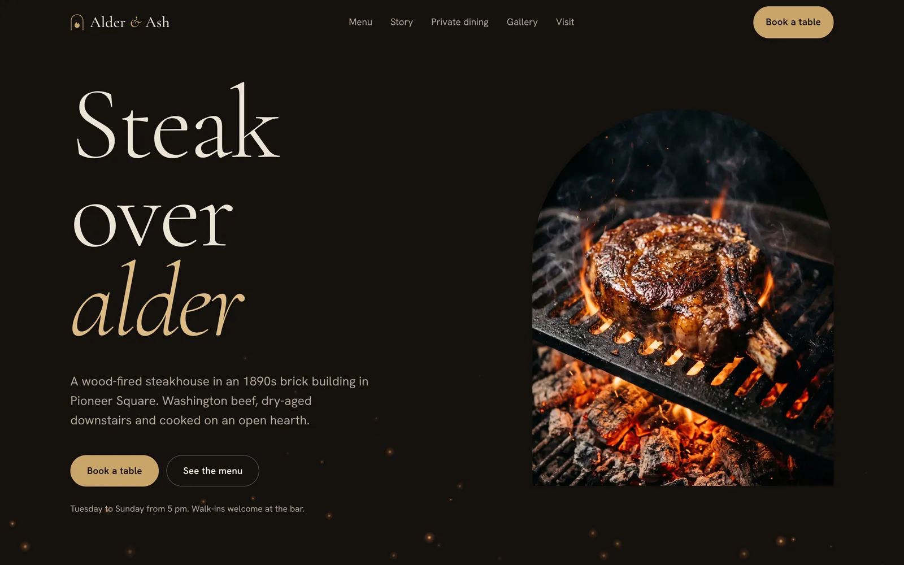
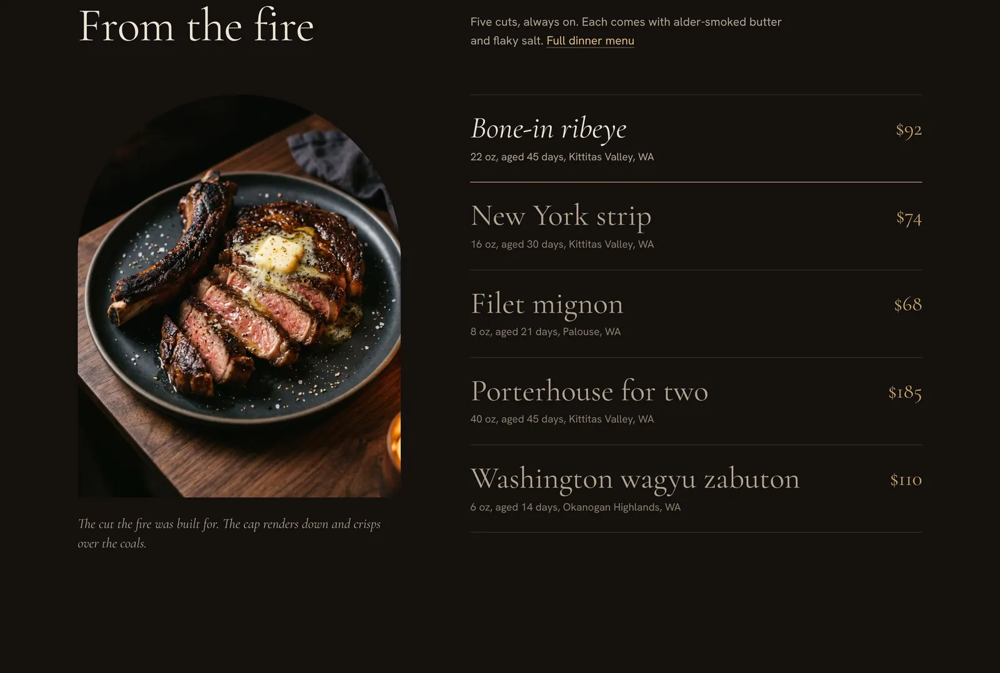
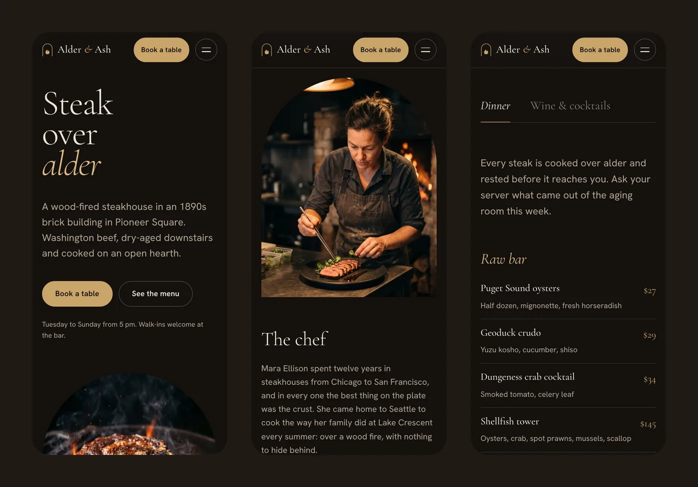
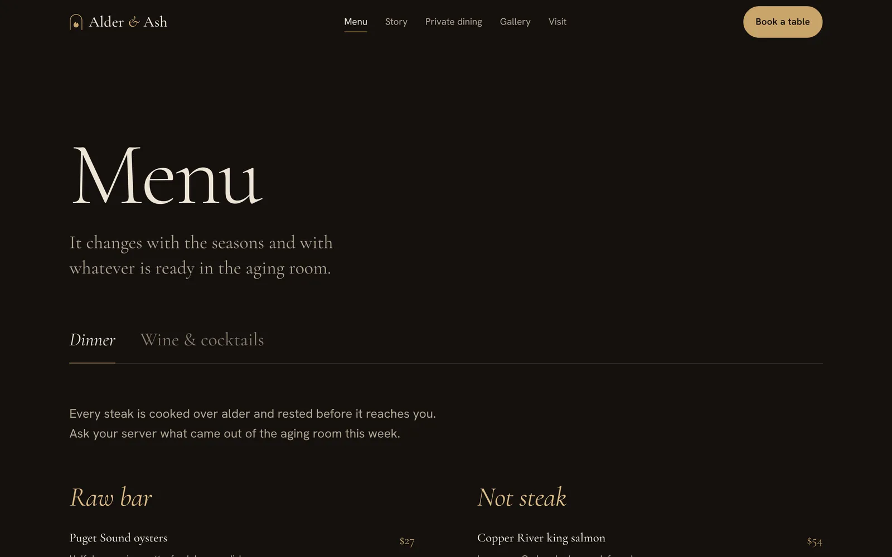
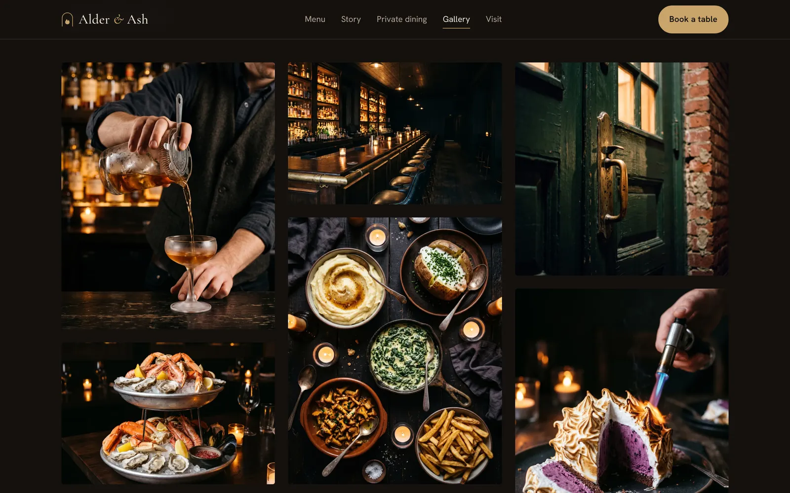

# Alder & Ash

**A website concept for a wood-fired steakhouse in Seattle, designed and built by [Designyum](https://designyum.com).**

### [View the live site →](https://alder-and-ash.designyum.com)

Alder & Ash is a fictional restaurant: a steakhouse in an 1890s brick building in Pioneer Square that cooks Washington beef over an open alder fire. The site was designed to feel like walking in from the rain: dark, warm and lit by the hearth.

**Want a site like this for your restaurant?** [Get in touch with Designyum](https://designyum.com). Every build is adapted to your name, menu, photography and booking system.

---

## What's inside

- **Seven pages:** home, menu, story, private dining, gallery, visit and reservations.
- **A signature-cuts showcase:** choosing a steak swaps the arched photo and its tasting note.
- **Menus that are easy to update:** dinner and drinks as tabs, with every dish and price kept in one data file.
- **Reservation and private-event forms** with clear, friendly validation: closed days, booking windows, and large parties steered to private dining.
- **A photo gallery** with a full-screen viewer that works with a keyboard and with a swipe on phones.

## Built for every screen

The layout is designed for phones first and scales up to large desktops. Phone visitors get the full experience, not a cut-down version.

## Motion that feels like firelight

- On arrival, the headline rises line by line, the hero photo opens upward like the mouth of a hearth, and embers drift up the screen.
- Photos unveil through their arched frames as you scroll, and the kitchen photo drifts gently behind the chef's quote.
- Pages crossfade into each other as you move around the site.
- Visitors who prefer reduced motion get the finished page with no animation, and every page still works with JavaScript turned off.

## Fast on any connection

- **Photos** are served as modern formats (AVIF and WebP) at the right size for each screen, and load only as they scroll into view.
- **Fonts** are hosted with the site, with no third-party requests.
- **Script** is light: about 45 KB, loaded after the page appears. The ember effect scales to the device and pauses when it's off screen.
- **Search engines** get structured restaurant data: hours, address and cuisine.

## Design

| | |
|---|---|
| **Palette** | Soot `#15110e`, charred oak `#201914`, bone `#ede4d6`, smoke `#b2a593`, brass `#c9a46a`, ember `#e0773a` |
| **Type** | Cormorant Garamond for display, Hanken Grotesk for text |
| **Signature shape** | The hearth arch: a tall frame with a fully rounded top, used on key photos |
| **Photography** | Art-directed and generated for this concept; prompts are in [IMAGE-PROMPTS.md](IMAGE-PROMPTS.md) |

**Built with** [Astro](https://astro.build) and [GSAP](https://gsap.com), deployed on [Vercel](https://vercel.com).

---

## For developers

Running, editing and deploying the site

### Commands

| Command           | What it does                                 |
| ----------------- | -------------------------------------------- |
| `npm install`     | Install dependencies (Node 20+)              |
| `npm run dev`     | Start a dev server at http://localhost:4321  |
| `npm run build`   | Type-check, then build the site into `dist/` |
| `npm run preview` | Serve the built site locally                 |

The first build takes a few minutes while it generates optimized versions of every photo.

### Editing content

All content is plain data, so a copy change never touches the layout code.

- `src/data/site.ts`: name, address, phone, emails, hours, parking and transit notes, nav links
- `src/data/menu.ts`: every menu section, dish and price, plus the five featured cuts
- `src/data/press.ts`: press quotes and awards (placeholders with invented outlets)
- `src/data/photos.ts`: the photo slots

The address, coordinates, 555 phone number and `.example` emails are deliberately fake.

### Photos

Every image is a named slot. Save a file named after a slot, such as `src/assets/photos/hero.jpg`, and the build crops it to the slot's ratio and serves it as AVIF/WebP at several widths. Empty slots show a labeled placeholder, and the gallery lists only slots that have a photo. [PHOTOS.md](PHOTOS.md) is the shot list.

### Forms

The reservation and private-dining forms validate in the browser and show a confirmation, but don't send data anywhere yet. To connect them, replace `submit()` in `src/scripts/forms.ts` with a call to a booking service (OpenTable, Resy, SevenRooms) or a form endpoint (Formspree, Supabase, a serverless function).

### Design tokens

Colors, type scale, spacing and easing are CSS variables at the top of `src/styles/global.css`.

### Deploying

`npm run build` produces static files in `dist/`, which run on any static host. This site is deployed on Vercel at https://alder-and-ash.designyum.com, set as `site` in `astro.config.mjs` for canonical URLs.

## License

© Designyum. All rights reserved. This repository is public as a portfolio piece: you're welcome to look around, but the design, code and photography may not be reused without permission. [Get in touch](https://designyum.com) about licensing a site like this.
